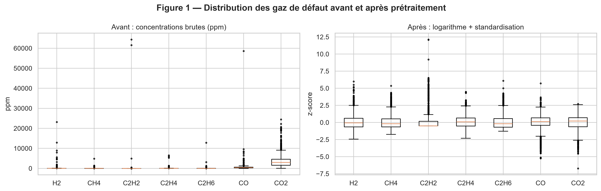
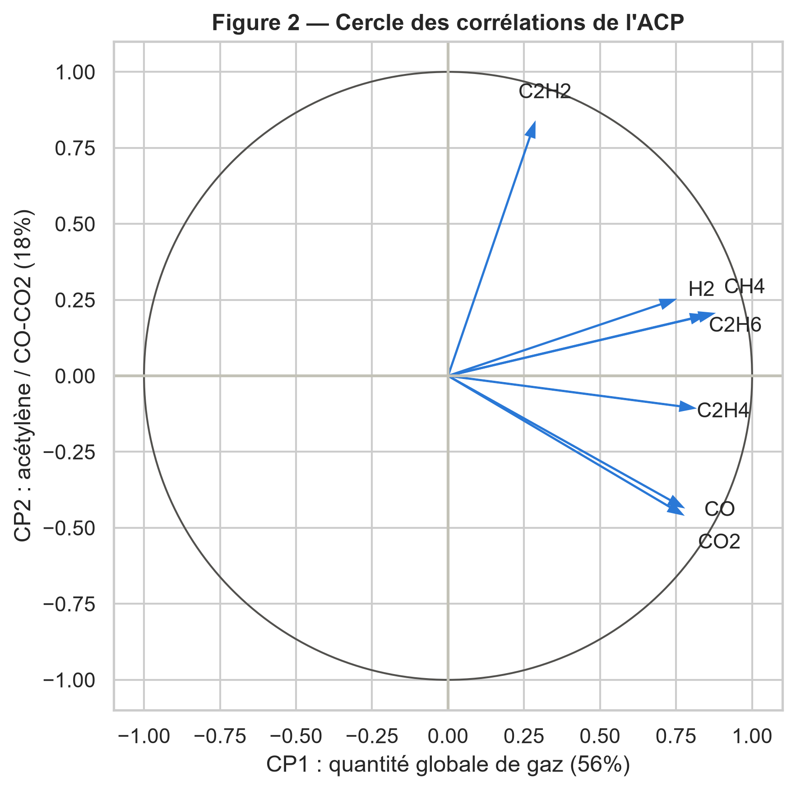
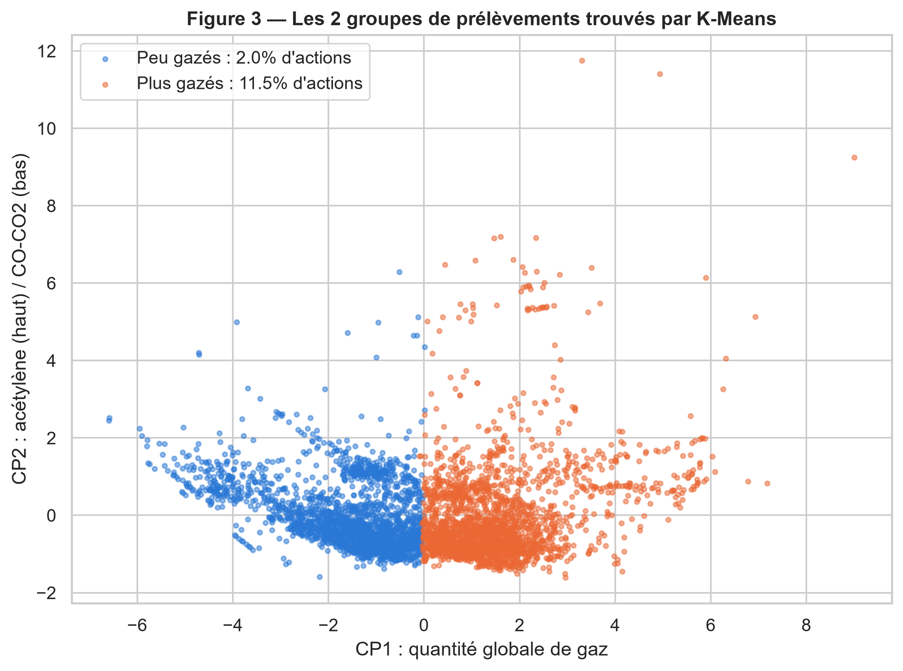
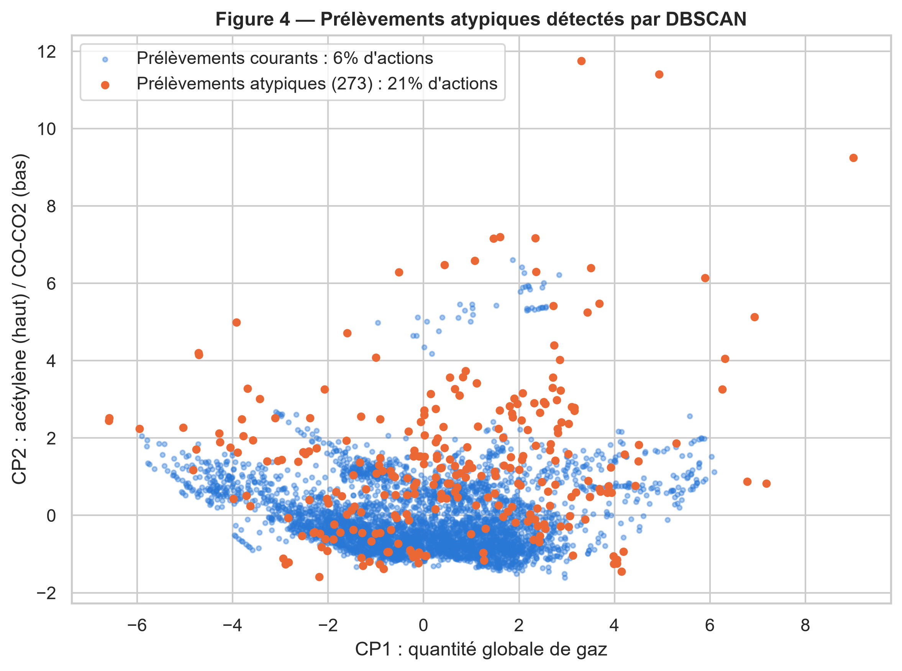
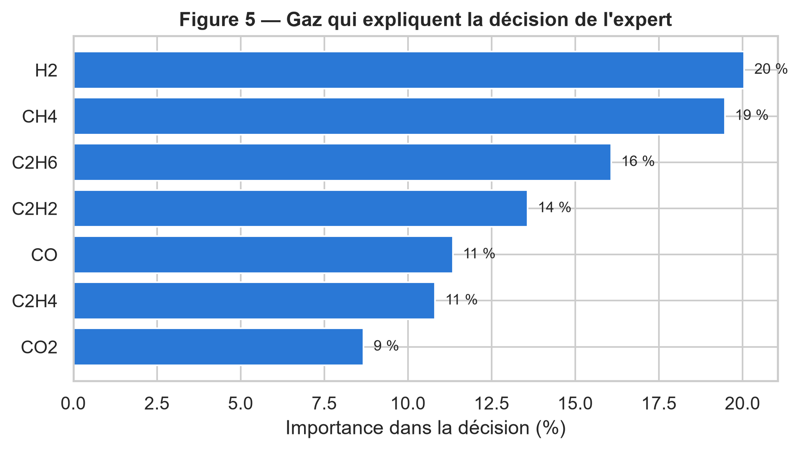
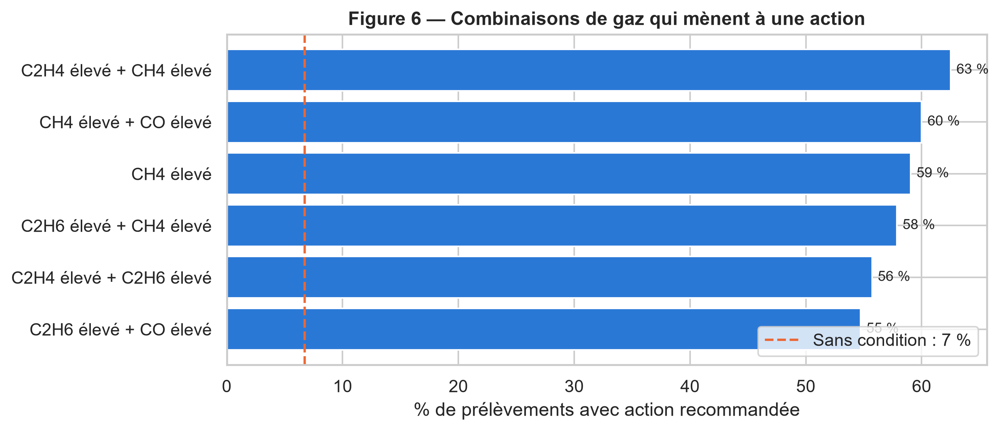
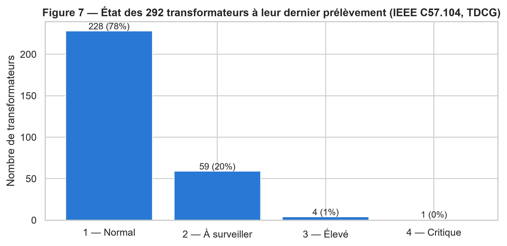
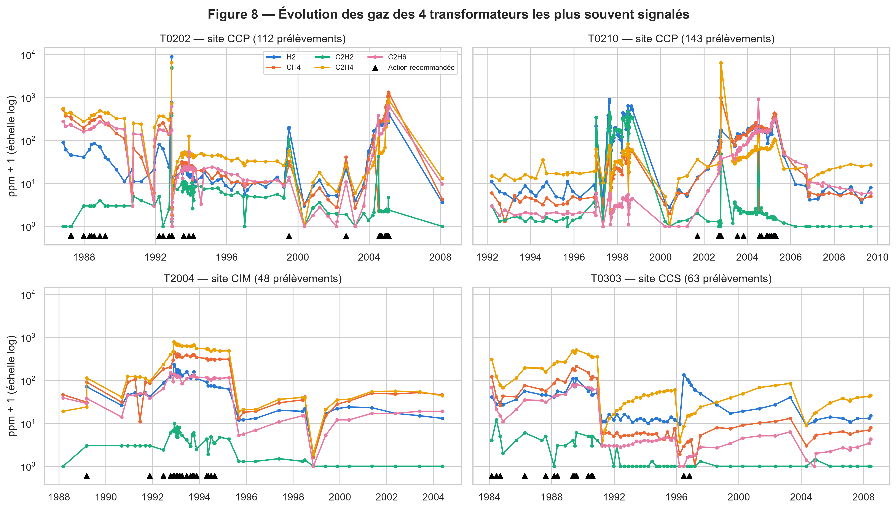
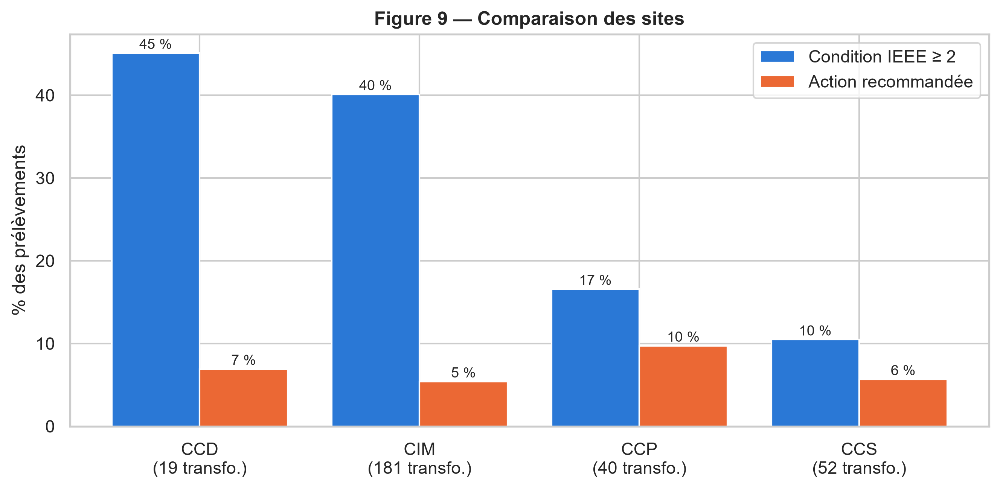

# Étape 5 — Visualisation et interprétation

## 5.1 Objectif

Cette étape rassemble les graphiques clés des étapes précédentes et ajoute trois visualisations utiles aux recommandations : l'état du parc, l'évolution dans le temps et la comparaison des sites. Elle pose ensuite les interprétations finales.

Toutes les figures sont enregistrées dans `rapport/figures/` (300 dpi) :

| Figure | Fichier | Contenu | Étape d'origine |
|---|---|---|---|
| 1 | `fig01_gaz_avant_apres_log.png` | Distribution des gaz avant / après prétraitement | 2 |
| 2 | `fig02_acp_cercle_correlations.png` | Cercle des corrélations de l'ACP | 2 |
| 3 | `fig03_kmeans_groupes.png` | Groupes K-Means sur le plan de l'ACP | 3 |
| 4 | `fig04_dbscan_points_isoles.png` | Prélèvements atypiques (DBSCAN) | 3 |
| 5 | `fig05_importance_gaz.png` | Importance des gaz (forêt aléatoire) | 3 |
| 6 | `fig06_regles_vers_action.png` | Règles d'association menant à une action | 4 |
| 7 | `fig07_etat_parc_ieee.png` | État du parc au dernier prélèvement (IEEE C57.104) | 5 (nouveau) |
| 8 | `fig08_evolution_gaz.png` | Évolution des gaz de 4 transformateurs | 5 (nouveau) |
| 9 | `fig09_comparaison_sites.png` | Comparaison des sites | 5 (nouveau) |

## 5.2 Récapitulatif des résultats

**Figure 1.** Les concentrations brutes sont écrasées par quelques valeurs extrêmes. Après logarithme et standardisation, les 7 gaz sont comparables, et ces valeurs extrêmes, signes de défauts, ont été conservées.

**Figure 2.** Deux axes résument 74 % de l'information :
- **CP1** mesure la quantité globale de gaz ;
- **CP2** oppose l'acétylène (arc électrique) au CO/CO2 (vieillissement du papier).

**Figure 3.** K-Means sépare les prélèvements **peu gazés** (2 % d'actions) des **plus gazés** (11,5 % d'actions), sans connaître l'avis de l'expert.

**Figure 4.** DBSCAN isole 6 % de prélèvements atypiques, riches en acétylène et en hydrogène. L'expert les juge 3,5 fois plus souvent à surveiller.

**Figure 5.** H2, CH4 et C2H6, les gaz des défauts actifs, guident le plus la décision de l'expert. CO et CO2 la guident le moins.

**Figure 6.** Quand CH4 et C2H4 sont élevés ensemble (surchauffe de l'huile), une action est recommandée dans 62 % des cas, contre 7 % en moyenne.

## 5.3 Nouvelles visualisations

### État du parc

Pour chaque transformateur, nous avons retenu son dernier prélèvement et sa condition IEEE C57.104, calculée sur le **TDCG** (H2 + CH4 + C2H2 + C2H4 + C2H6 + CO) avec les seuils de la base : 720, 1 920 et 4 630 ppm.

| Condition | Transformateurs |
|---|---:|
| 1 — Normal | 228 (78 %) |
| 2 — À surveiller | 59 (20 %) |
| 3 — Élevé | 4 |
| 4 — Critique | 1 |

- **T0218C (site CCP) est en condition 4.** Son TDCG atteint 6 768 ppm, avec 5 269 ppm d'éthylène, 1 135 ppm d'éthane et 124 ppm d'acétylène : c'est une surchauffe sévère de l'huile, accompagnée d'un arc électrique.
- **T2003, T2005, T0404 et T2006 (site CIM) sont en condition 3.** Leur TDCG est tiré par le CO (1 800 à 2 200 ppm) : c'est un vieillissement avancé du papier isolant.
- **Le « dernier prélèvement » n'est souvent pas récent.** Environ 140 transformateurs n'ont plus été analysés depuis 2000, et seulement 104 l'ont été en 2008-2009.

### Évolution des gaz dans le temps

- **Les actions arrivent en série pendant les hausses de gaz** : par exemple T0202 en 1992-1993 et en 2004-2005, ou T2004 en 1992-1995.
- **Les gaz chutent ensuite brutalement**, d'un facteur 10 à 100. C'est très probablement le signe d'une intervention (traitement de l'huile ou réparation), et les recommandations s'arrêtent alors.
- **L'expert réagit à la tendance**, et pas seulement à une valeur isolée. C'est la principale limite des modèles des étapes 3 et 4, qui regardent un prélèvement à la fois.

### Comparaison des sites

| Site | Transformateurs | Prélèvements | Condition IEEE ≥ 2 | Action recommandée |
|---|---:|---:|---:|---:|
| CCD | 19 | 590 | 45 % | 7 % |
| CIM | 181 | 1 868 | 40 % | 5 % |
| CCP | 40 | 1 020 | 17 % | 10 % |
| CCS | 52 | 860 | 11 % | 6 % |

- **CCD et CIM** ont le plus de prélèvements au-dessus de la normale. Ce dépassement vient surtout du CO, donc du vieillissement du papier.
- **CCP** reçoit le plus d'actions, car c'est là que se concentrent les **défauts actifs**. On y trouve les transformateurs les plus souvent signalés (T0202 et T0210) ainsi que le transformateur critique T0218C.

## 5.4 Interprétations finales

| N° | Constat | Figures |
|---|---|---|
| 1 | La majorité du parc est saine : 78 % des transformateurs sont en condition 1 | 7 |
| 2 | Deux familles de phénomènes : le vieillissement du papier (CO, CO2 : lent, fréquent) et les défauts actifs (H2, CH4, C2H6, C2H4, C2H2 : rares, graves) | 2, 6, 9 |
| 3 | La surchauffe de l'huile est le premier déclencheur d'action | 5, 6 |
| 4 | Les méthodes non supervisées retrouvent la logique de l'expert | 3, 4 |
| 5 | La tendance compte plus qu'une valeur isolée | 8 |
| 6 | Priorités : T0218C (critique), 4 transformateurs CIM en condition 3, site CCP | 7, 9 |
| 7 | Le suivi est irrégulier : environ 140 transformateurs n'ont plus été analysés depuis 2000 | 7 |
